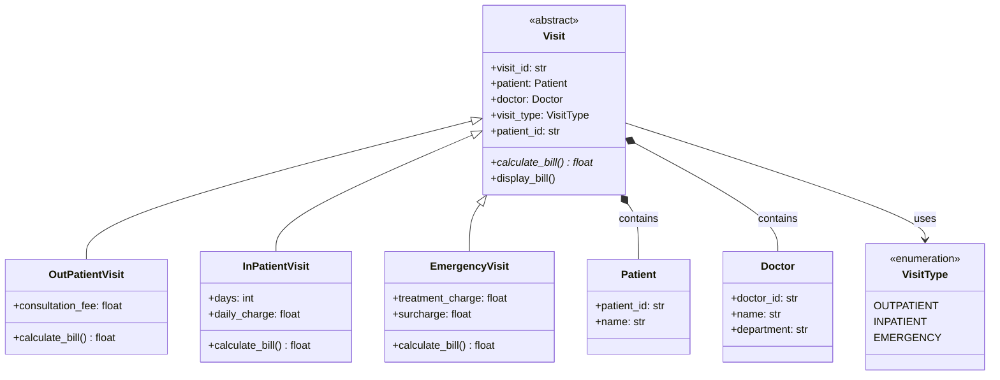

# Hospital Billing Model – Class Diagram

## UML Class Diagram

## Class Descriptions

### 1. VisitType
An enumeration that defines three types of hospital visits:
- OUTPATIENT
- INPATIENT
- EMERGENCY

### 2. Patient
Stores patient information:
- Patient ID
- Patient Name

### 3. Doctor
Stores doctor information:
- Doctor ID
- Doctor Name
- Department

### 4. Visit (Abstract Class)
The common parent class for all hospital visits.

Responsibilities:
- Store visit information.
- Associate Patient and Doctor objects.
- Expose patient_id through a read-only property.
- Define calculate_bill() as an abstract method.
- Provide a common billing report interface.

### 5. OutPatientVisit
Inherits from Visit.

Calculates the bill using the consultation fee.

### 6. InPatientVisit
Inherits from Visit.

Calculates the bill using the number of admission days and daily charge.

### 7. EmergencyVisit
Inherits from Visit.

Calculates the bill by adding the emergency surcharge to the treatment charge.

## Relationships

- OutPatientVisit, InPatientVisit and EmergencyVisit inherit from Visit.
- Visit contains a Patient object.
- Visit contains a Doctor object.
- Visit uses VisitType to identify the visit category.
- All visit subclasses implement calculate_bill() independently.

## Design Principles

### Inheritance
Visit subclasses share the common structure and behaviour of the abstract Visit class.

### Composition
Visit HAS-A Patient and HAS-A Doctor.

Patient and Doctor are separate entities associated with a visit.

### Polymorphism
A single loop processes all visit objects using their own calculate_bill() implementations.
