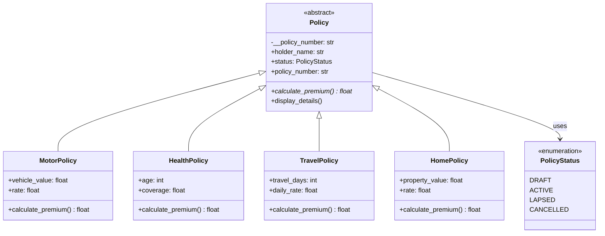

# Insurance Policy Hierarchy – Class Diagram

## UML Class Diagram

## Class Description

### 1. PolicyStatus
An enumeration containing the four possible policy statuses:
- DRAFT
- ACTIVE
- LAPSED
- CANCELLED

### 2. Policy (Abstract Class)
The common parent class for all insurance policies.

Responsibilities:
- Store policy number, holder name and status.
- Validate the policy number through a property setter.
- Define the abstract calculate_premium() method.
- Provide a common display_details() method.

### 3. MotorPolicy
Inherits from Policy.

Calculates premiums based on vehicle value and insurance rate.

### 4. HealthPolicy
Inherits from Policy.

Calculates premiums based on coverage amount and applies an additional charge for policyholders above 50 years.

### 5. TravelPolicy
Inherits from Policy.

Calculates premiums based on travel duration and daily rate.

### 6. HomePolicy
Inherits from Policy.

Calculates premiums based on property value and insurance rate.

It demonstrates the Open/Closed Principle by extending the existing system without modifying existing policy classes.

## Relationships

- MotorPolicy, HealthPolicy, TravelPolicy and HomePolicy inherit from Policy.
- Policy uses PolicyStatus to maintain the status of each policy.
- All subclasses implement calculate_premium() independently.
- The common Policy interface enables runtime polymorphism.
