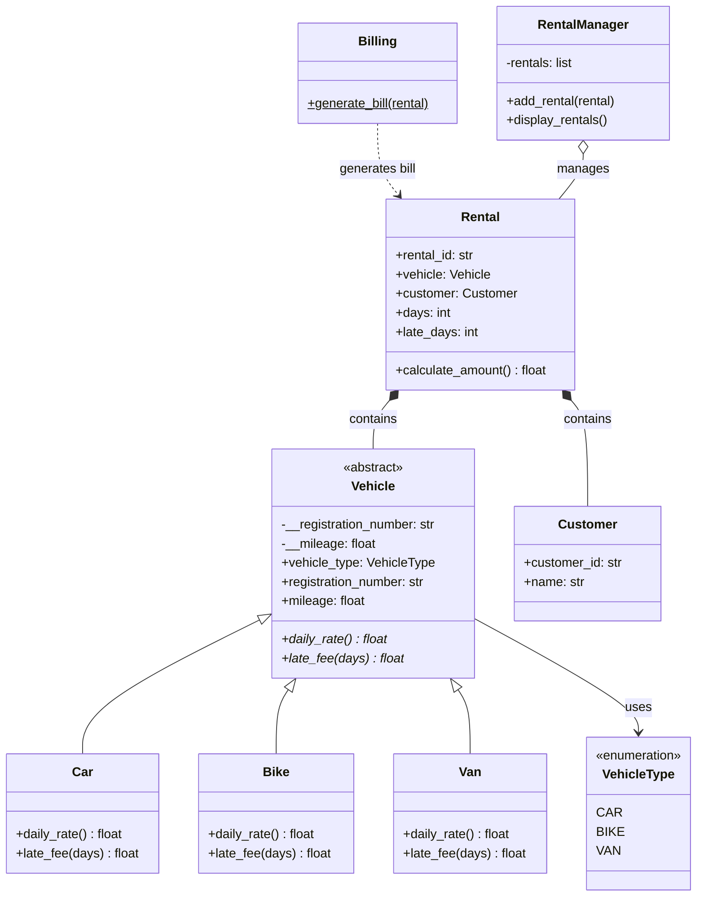

# Vehicle Rental System – Class Diagram

## UML Class Diagram

## Class Descriptions

### 1. VehicleType
An enumeration that defines the available vehicle types:
- CAR
- BIKE
- VAN

### 2. Vehicle (Abstract Class)
The common parent class for all vehicles.

Responsibilities:
- Store registration number, mileage and vehicle type.
- Validate registration number and mileage.
- Define daily_rate() and late_fee() as abstract methods.

### 3. Car
Inherits from Vehicle.

- Daily rate: Rs.2,000
- Late fee: Rs.500 per day.

### 4. Bike
Inherits from Vehicle.

- Daily rate: Rs.500
- Late fee: Rs.100 per day.

### 5. Van
Inherits from Vehicle.

- Daily rate: Rs.3,000
- Late fee: Rs.800 per day.

### 6. Customer
Stores customer ID and customer name.

### 7. Rental
Represents a rental transaction.

Contains:
- One Vehicle object.
- One Customer object.
- Rental duration.
- Late days.

Calculates the total rental amount.

### 8. Billing
Generates individual rental bills.

### 9. RentalManager
Maintains the rental list, displays rental reports and calculates total revenue.

## Relationships

- Car, Bike and Van inherit from Vehicle.
- Rental contains Vehicle and Customer objects (HAS-A relationship).
- Billing uses Rental to generate bills.
- RentalManager manages multiple Rental objects.
- Vehicle uses VehicleType to identify the vehicle category.

## Design Principles

### Composition
Rental contains Vehicle and Customer objects instead of inheriting from them.

### Single Responsibility Principle
Each class handles a separate responsibility, making the system modular and maintainable.
